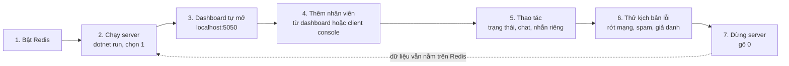
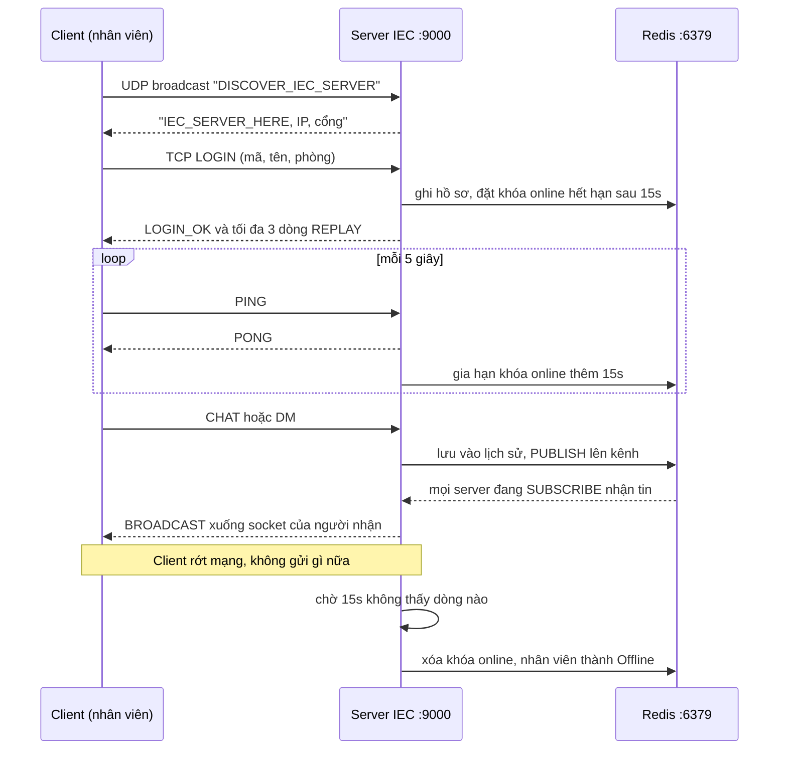

# Bảng sử dụng IEC — macOS và Windows

Trang này để tra nhanh: quy trình làm việc, lệnh tương ứng trên hai hệ điều hành, và các con số chuẩn (baseline) để biết hệ thống đang chạy đúng. Hướng dẫn test từng bước nằm ở [macOS](HUONG_DAN_TEST_MACOS.md) và [Windows](HUONG_DAN_TEST_WINDOWS.md).

## 1. Quy trình làm việc

Thứ tự bắt buộc là Redis trước, server sau. Client và dashboard chỉ dùng được khi server đang chạy.

## 2. Bảng lệnh theo hệ điều hành

| Bước | Việc cần làm               | macOS                                                                    | Windows (PowerShell)                                                                               |
| :--: | :------------------------- | :----------------------------------------------------------------------- | :------------------------------------------------------------------------------------------------- |
|  0   | Cài đặt (một lần)          | `brew install dotnet@9 redis`                                            | `winget install Microsoft.DotNet.SDK.9` và cài Docker Desktop                                      |
|  0   | Cho terminal thấy `dotnet` | Thêm `export PATH="/opt/homebrew/opt/dotnet@9/bin:$PATH"` vào `~/.zshrc` | Mở terminal mới sau khi cài                                                                        |
|  0   | Lấy code                   | `git clone https://github.com/bitmap1701/iec.git`                        | Giống macOS                                                                                        |
|  1   | Bật Redis                  | `brew services start redis`                                              | Lần đầu: `docker run -d --name iec-redis -p 6379:6379 redis` Lần sau: `docker start iec-redis` |
|  1   | Kiểm tra Redis             | `redis-cli ping`                                                         | `docker exec iec-redis redis-cli ping`                                                             |
|  2   | Chạy server                | `dotnet run` → `1` → Enter → Enter                                       | Giống macOS                                                                                        |
|  2   | Chạy server thứ hai        | `dotnet run` → `1` → Enter → `9100`                                      | Giống macOS                                                                                        |
|  3   | Mở dashboard               | Tự mở; nếu không: `open http://localhost:5050`                           | Tự mở; nếu không: `start http://localhost:5050`                                                    |
|  4   | Chạy client console        | `dotnet run` → `2` → Enter (tự dò) hoặc gõ `IP:cổng`                     | Giống macOS                                                                                        |
|  4   | Xem IP máy mình            | `ipconfig getifaddr en0`                                                 | `ipconfig` (dòng IPv4 Address)                                                                     |
|  6   | Gõ lệnh thô vào server     | `nc 127.0.0.1 9000`                                                      | Không có sẵn; dùng `ncat 127.0.0.1 9000` (đi kèm Nmap) hoặc bỏ qua                                 |
|  6   | Làm Redis chết thử         | `brew services stop redis` rồi `start`                                   | `docker stop iec-redis` rồi `docker start iec-redis`                                               |
|  7   | Dừng server                | Gõ `0` ở menu admin                                                      | Giống macOS                                                                                        |
|  —   | Cổng 9000 bị chiếm         | `lsof -ti tcp:9000 \| xargs kill`                                        | `netstat -ano \| findstr :9000` rồi `taskkill /PID <số> /F`                                        |
|  —   | Xóa sạch dữ liệu Redis     | `redis-cli FLUSHALL`                                                     | `docker exec iec-redis redis-cli FLUSHALL`                                                         |
|  —   | Cho máy khác nối vào       | Chọn Allow khi macOS hỏi                                                 | Tường lửa: tích **Private networks** rồi Allow                                                     |

## 3. Luồng dữ liệu khi hệ thống chạy

## 4. Baseline — hệ thống chạy đúng thì trông như thế nào

### Trước khi chạy

| Kiểm tra | Kết quả chuẩn |
| :--- | :--- |
| `dotnet --version` | `9.0.x` |
| Redis `ping` | `PONG` |
| `dotnet build` | `0 Error(s)`, `0 Warning(s)` |
| Sau khi chọn `1` | Thấy `[REDIS OK]`, `[WEB UI READY]`, `[TCP SERVER] Đang lắng nghe tại …` |

### Cổng mạng

| Cổng | Giao thức | Dùng cho |
| :---: | :---: | :--- |
| 9000 | TCP | Server IEC (đổi được khi khởi động) |
| 9001 | UDP | Trả lời dò tìm server |
| 5050 | HTTP | Dashboard (= 5050 + cổng TCP − 9000) |
| 6379 | TCP | Redis |

### Thời gian và giới hạn

| Thông số | Giá trị chuẩn | Thấy ở đâu |
| :--- | :--- | :--- |
| Chu kỳ `PING` | 5 giây | Thanh TTL đầy lại mỗi 5 giây |
| Khóa online hết hạn | 15 giây | Thanh TTL dao động trong khoảng 10–15s khi bình thường |
| RTT đầu tiên xuất hiện | Khoảng 10 giây sau khi đăng nhập | Cột RTT đổi từ `-` sang số |
| RTT trên cùng một máy | Khoảng 1–5 ms | Cột RTT |
| Đóng client đột ngột → Offline | 1–2 giây | Log `[DROP] … (EOF)` |
| Rớt mạng im lặng → Offline | Khoảng 15 giây | Log `[HALF-OPEN]` |
| Giới hạn spam | 25 dòng lệnh / 10 giây | Log `[SECOPS]` |
| Thời gian bị khóa | 30 giây | Nhãn `BLOCKED` đếm ngược |
| Chờ trả lời dò UDP | 1,8 giây | Client in "Không có Server nào trả lời" nếu quá hạn |
| Lịch sử chat lưu | 50 tin gần nhất | Khung "Lịch sử chat" |
| Phát lại khi đăng nhập | Tối đa 3 tin | Dòng `REPLAY` ở client |
| Độ dài một dòng lệnh | Tối đa 4096 ký tự | Quá giới hạn thì bị ngắt |

Các con số RTT và thời gian chuyển Offline là số đo được khi chạy thử trên một máy macOS. Trên hai máy qua Wi-Fi, RTT sẽ cao hơn.

## 5. Muốn làm gì thì làm ở đâu

| Muốn làm | Dashboard | Client console | Kết quả thấy |
| :--- | :--- | :--- | :--- |
| Thêm nhân viên | Ô "Mở kết nối nhân viên mới" → **+ Mở TcpClient mới** | Chạy `dotnet run`, chọn `2` | Thêm một dòng nhãn Online |
| Đổi trạng thái | Nút **Online / Busy / Away** | Menu `1`, `2`, `3` | Nhãn đổi màu |
| Chat chung | Ô người nhận để `ALL`, bấm **Gửi** | Menu `4`, Enter ở ô người nhận | Mọi người nhận `[CHAT TỪ …]` |
| Nhắn riêng | Ô người nhận gõ mã NV, bấm **Gửi** | Menu `4`, gõ mã người nhận | Chỉ người nhận thấy; người gửi nhận `DM_OK` |
| Thông báo của Admin | Ô trên cùng → **Phát thông báo** | Menu admin `1` (terminal server) | Mọi người nhận `[THÔNG BÁO TỪ ADMIN]` |
| Xem số PING và RTT | Khung bên phải, dòng "Số PING · RTT" | Menu `5` | Số nhịp và độ trễ |
| Giả lập rớt mạng | **A. Rớt mạng: im lặng, không FIN** | Tắt Wi-Fi của máy client | Offline sau khoảng 15s |
| Giả lập spam | **B. Spam 30 dòng lệnh** | Menu `6` | `BLOCKED` 30s |
| Đăng xuất | **C. Đăng xuất chuẩn (LOGOUT)** | Menu `0` | Offline ngay |
| Kết nối lại | **Kết nối lại TCP** | Chạy lại client | Online trở lại |
| Xóa nhân viên | **Xóa nhân viên khỏi Redis** | Không có | Dòng biến mất khỏi bảng |
| Bật log PING trên terminal | Không có | Menu admin `2` (terminal server) | Terminal in từng nhịp PING |

Mỗi nhân viên tạo từ dashboard là một kết nối TCP thật do server mở giúp, nên các nút bấm đi đúng giao thức như client console.

## 6. Đọc tín hiệu trên dashboard

| Tín hiệu | Nghĩa là |
| :--- | :--- |
| Nhãn **● Online / Busy / Away** | Khóa online còn hạn trên Redis |
| Nhãn **Offline** | Khóa online đã bị xóa hoặc hết hạn |
| Nhãn **BLOCKED 23s** | Đang bị khóa vì spam, còn 23 giây |
| Thanh TTL xanh | Còn hơn 6 giây trước khi hết hạn |
| Thanh TTL đỏ | Còn 6 giây trở xuống: không có `PING` nào tới |
| Huy hiệu **Socket mở / Socket đóng** | Nhân viên có đang nối vào đúng server này hay không |
| Log `[LOGIN]`, `[PING]`, `[STATUS]` | Server vừa nhận lệnh tương ứng |
| Log `[PUBSUB]` | Redis vừa đẩy một tin chat về server này |
| Log `[UDP-9001]` | Có client vừa dò tìm server |
| Log `[DROP]` | Một kết nối vừa kết thúc không qua LOGOUT |
| Log `[SECOPS]` | Một lệnh bị từ chối: chưa đăng nhập, sai mã, spam, dòng quá dài |
| Log `[ERROR]` | Lỗi ngoài dự kiến, thường là mất kết nối tới Redis |
